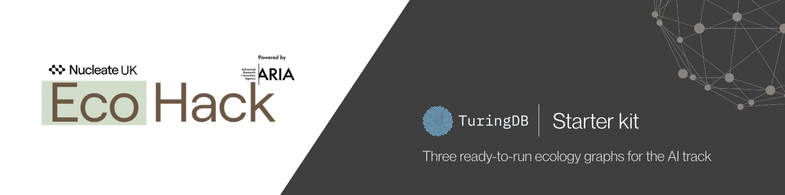
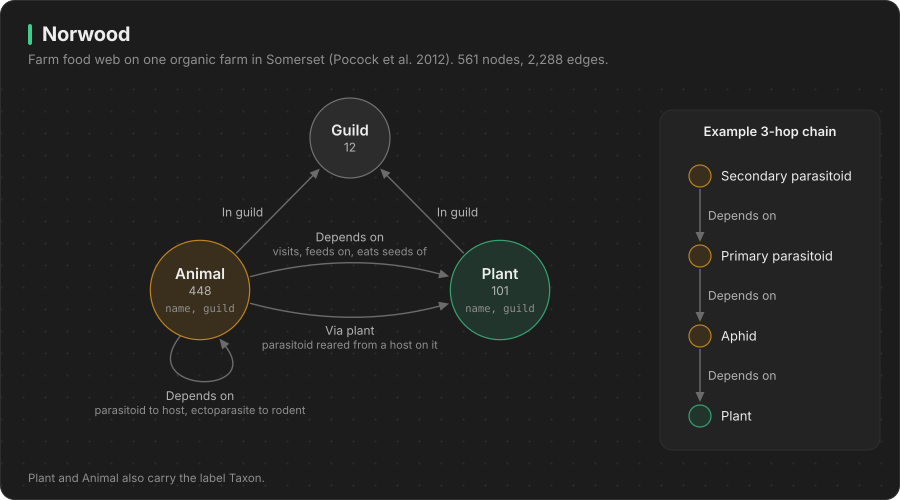
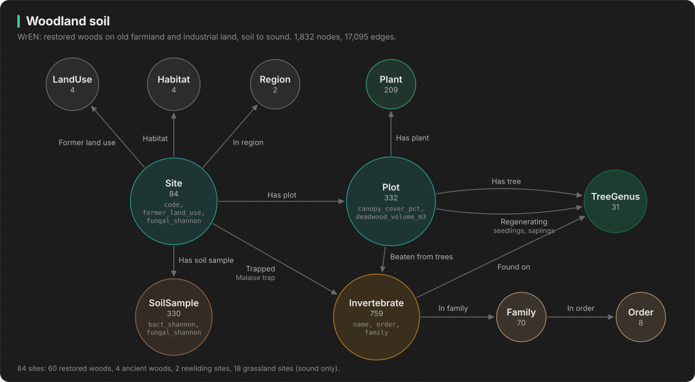
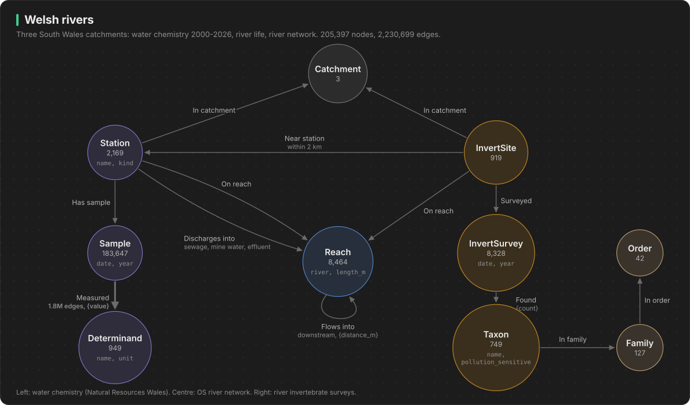

# EcoHack graphs

Three ready-to-query graphs built from the EcoHack 2026 AI-track open datasets, running on [TuringDB](https://docs.turingdb.ai).

| Graph | In one line | Size | Good for |
|---|---|---|---|
| [`norwood`](docs/norwood.md) | Who eats, pollinates or parasitises whom on one Somerset farm | 549 species, 1,728 links | Keystone species, extinction cascades, restoration planting |
| [`woodland_soil`](docs/woodland_soil.md) | 84 woods and grasslands with soil microbes, plants, trees, insects and soundscape | 1.8k nodes, 17k edges | Land-use legacy, recovery after restoration, cheap monitoring |
| [`welsh_rivers`](docs/welsh_rivers.md) | 26 years of river chemistry plus river invertebrates on the real river network | 205k nodes, 2.2M edges | Pollution tracing, cause and effect, speed at scale |

Each graph joins several datasets so you can ask **multi-hop** questions that are painful in spreadsheets or SQL. Examples:
- "If this plant disappears, which species lose all their food, and which parasitoids starve after them?"
- "Which sewage works and mine outfalls sit upstream of the river sites that lost their mayflies?"

These run in milliseconds.

## Quick start

You need [uv](https://docs.astral.sh/uv/getting-started/installation/) and **macOS 15+ on Apple silicon, or Linux**.

```bash
git clone <this repo> && cd ecohack_graphs
./start.sh
```

The first run imports the graphs, which takes about 10 seconds. Then:

- **Visualizer:** open http://localhost:8080, pick a graph, and explore.
- **Example queries:** `uv run python queries/run.py norwood`. Do the same for `woodland_soil` and `welsh_rivers`.
- **Extinction cascade:** `uv run python queries/norwood_cascade.py "Cirsium arvense"`.
- **Your own Python:**

  ```python
  from turingdb import TuringDB
  c = TuringDB(host="localhost", port=6666)
  c.set_graph("norwood")
  c.query("MATCH (p:Plant)<-[:DEPENDS_ON*1..3]-(a:Animal) RETURN p.name, count(DISTINCT a) AS supported ORDER BY supported DESC LIMIT 5")
  ```

- **Stop:** `./stop.sh`. The graphs stay on disk, and the next `./start.sh` loads them in seconds.

**On macOS 14 or older, an Intel Mac, or Windows**, there is no TuringDB wheel for your machine. Use Docker instead:

```bash
docker compose up -d     # same ports: 6666 for Python, 8080 for the visualizer
```

Then install the Python client on your machine, or run the examples inside the container:

```bash
docker compose exec turingdb uv run python queries/run.py norwood
```

## Using it with Claude

The repo is set up for [Claude Code](https://claude.com/claude-code). Open the folder and ask in plain English:

```bash
cd ecohack_graphs && claude
```

> Start the graphs and tell me which plants on Norwood Farm are keystone species.

> Which river sites lost the most pollution-sensitive invertebrates, and what discharges are upstream of them?

> Do woods planted on old industrial land have different soil fungi from woods on old farmland? Make a chart.

Claude reads `CLAUDE.md` and the TuringDB skill in `.claude/skills/turingdb/`. The skill holds the tested Cypher rules for TuringDB 3.1 and the schema of each graph. With them, Claude can start the server, write multi-hop queries, run them, and turn results into pandas tables and charts.

## The three graphs

### norwood: the farm food web



Pocock, Evans and Memmott sampled 7 interaction networks on one farm at once:
- plants and their flower visitors
- aphids and two levels of parasitoid wasps
- leaf-miner parasitoids
- seed-feeding insects and their parasitoids
- seed-eating birds
- seed-eating rodents and their fleas and ticks

Plants are the hubs that tie it together.

```
(:Animal)-[:DEPENDS_ON]->(:Plant)       (:Animal)-[:DEPENDS_ON]->(:Animal)       (:Animal)-[:VIA_PLANT]->(:Plant)
```

Questions: which plants are keystone species within 3 hops? Which species have a single food source? How far does an extinction cascade run? Which flower visitors compete? [Schema and details](docs/norwood.md).

### woodland_soil: restoring woodland, from soil to sound



The WrEN project surveyed 60 young woods planted on old farmland or industrial land in Scotland and England, plus ancient woods and rewilding sites. At each site:
- soil bacteria and fungi diversity
- ground plants
- every tree
- insects from traps and from beating named trees
- a week of sound recordings

```
(:LandUse)<-(:Site)-[:HAS_PLOT]->(:Plot)-[:HAS_PLANT|HAS_TREE|BEATEN_FROM_TREES]->(...)
(:Invertebrate)-[:FOUND_ON]->(:TreeGenus)       (:Site)-[:HAS_SOIL_SAMPLE]->(:SoilSample)
```

Questions: does former land use still show in the soil? Which young woods already look like ancient woodland? Which trees host insects found nowhere else? Does the soundscape track biodiversity? [Schema and details](docs/woodland_soil.md).

### welsh_rivers: chemistry, river life and the river network



The graph covers three South Wales catchments:
- 1.8 million water-quality measurements, 2000–2026, from rivers, sewage works, industrial outfalls, mine-water discharges and landfills
- river invertebrate surveys
- the OS river network with its flow direction

```
(:Station)-[:HAS_SAMPLE]->(:Sample)-[:MEASURED {value}]->(:Determinand)
(:Station)-[:DISCHARGES_INTO|ON_REACH]->(:Reach)-[:FLOWS_INTO]->(:Reach)<-[:ON_REACH]-(:InvertSite)
(:InvertSite)-[:SURVEYED]->(:InvertSurvey)-[:FOUND]->(:Taxon {pollution_sensitive})
```

Questions: which discharges are upstream of a declining site? How many invertebrate sites does each mine outfall reach? What is the river distance from an outfall to a site? Where are the monitoring gaps? [Schema and details](docs/welsh_rivers.md).

## Repo layout

| Path | What |
|---|---|
| `graphs/*.jsonl.gz` | The three graphs, imported by `./start.sh` |
| `docs/` | One page per graph: sources, schema, properties, questions, caveats |
| `queries/*.cypher` | 10 tested example queries per graph, run with `queries/run.py` |
| `queries/norwood_cascade.py` | Iterative extinction cascade |
| `.claude/skills/turingdb/` | TuringDB 3.1 skill for Claude (tested dialect rules and recipes) |
| `CLAUDE.md` | Instructions Claude follows in this repo |
| `build/` | Scripts that rebuild every graph from the original downloads ([how](build/README.md)) |
| `start.sh`, `stop.sh`, `Dockerfile` | Run TuringDB locally or in Docker |
| `CITATIONS.md` | Licences and how to cite each dataset |

## TuringDB in 60 seconds

- Queries use **Cypher**: `MATCH (a)-[:REL]->(b) WHERE ... RETURN ...`. Arrows follow relationships, and `*1..3` follows them 1 to 3 times.
- Results come back as **pandas DataFrames**.
- Explore a graph's schema with `CALL db.labels()`, `CALL db.edgeTypes()` and `CALL db.propertyTypes()`.
- Unknown names return no rows instead of an error, so check spelling when a result is empty.
- Every write is versioned, like git commits. You can add your own nodes, edges and scores without losing the original (see the skill, section 5).

## Data and licences

All data is open. See [CITATIONS.md](CITATIONS.md) for how to cite each source:
- Norwood: CC0
- UKCEH/EIDC and NRW: Open Government Licence
- KiEco via GBIF: CC BY 4.0
- OS Open Rivers: Open Government Licence
