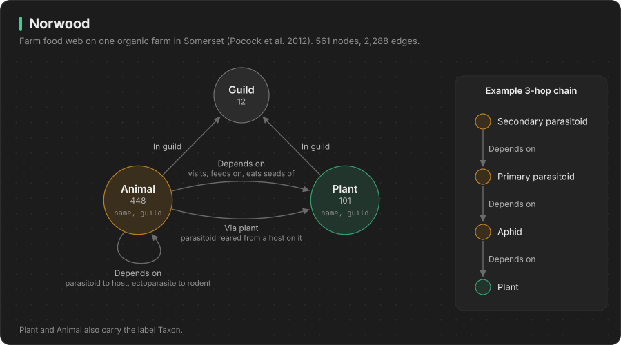

# norwood: the farm food web



**Use it for:** keystone species, extinction cascades, single points of failure, restoration planting.

## What the data is

Norwood Farm is an organic farm in Somerset. In 2007 and 2008, Pocock, Evans and Memmott recorded who eats, visits, or parasitises whom across 10 habitats on the farm. Most food-web studies cover one kind of interaction. This one samples 7 networks at the same time, all tied together through the plants:

- plants and their flower visitors (bees, hoverflies, butterflies)
- plants and aphids, aphids and their parasitoid wasps, and the wasps that parasitise those wasps
- plants and the parasitoids of leaf miners
- plants and seed-feeding insects, and those insects' parasitoids
- plants and seed-eating birds
- plants and seed-eating rodents, and the rodents' ectoparasites (fleas, ticks)

Each link has an estimated interaction strength: how much that interaction happens on the whole farm in one year.

Source: Pocock MJO, Evans DM, Memmott J (2012) *The robustness and restoration of a network of ecological networks*. Science 335: 973-977. Data: Dryad [doi:10.5061/dryad.3s36r118](https://doi.org/10.5061/dryad.3s36r118), CC0.

## Size

561 nodes, 2,288 edges. This is small enough to draw in full in the visualizer.

| Node | Count | What it is |
|---|---|---|
| `Taxon` | 549 | Every species or group. Each one is also a `Plant` (101) or an `Animal` (448). |
| `Guild` | 12 | The role a taxon plays, for example `flower visitor`, `aphid` or `seed-feeding bird` |

## Schema

```
(:Animal)-[:DEPENDS_ON]->(:Plant)        plant users: flower visitors, aphids, seed feeders, birds, rodents
(:Animal)-[:DEPENDS_ON]->(:Animal)       parasitoids -> their hosts, ectoparasites -> rodents
(:Animal)-[:VIA_PLANT]->(:Plant)         parasitoid reared from a host that was living on this plant
(:Taxon)-[:IN_GUILD]->(:Guild)
```

`DEPENDS_ON` always points from the consumer to what it needs. To find everything that depends on a plant, follow the arrows backwards: `(p:Plant)<-[:DEPENDS_ON*1..3]-(a)`.

### Properties

| On | Property | Meaning |
|---|---|---|
| `Taxon` | `name` | Scientific name, as precise as it was identified (`sp` means genus only) |
| | `guild` | Main guild |
| | `kind` | `plant` or `animal` |
| | `identified_to` | `species`, `genus or aggregate`, or `higher taxon or morphospecies` |
| `DEPENDS_ON` | `interaction` | `visits flowers of`, `feeds on`, `eats seeds of`, `parasitises`, `parasitises leaf miners on` |
| | `strength` | Estimated interaction strength for the whole farm in one year. The units differ between networks, so compare it only within one `network`. |
| | `network` | For example `plant - flower visitor` |
| | `hops` | Always 1.0, so it can be used as a weight for `shortestPath` |
| `VIA_PLANT` | `strength`, `network`, `hops` | As above |

## Questions it answers

All of these are in [`queries/norwood.cypher`](../queries/norwood.cypher). The cascade is in [`queries/norwood_cascade.py`](../queries/norwood_cascade.py).

1. **Keystone ranking.** Which plants hold up the most species within 1, 2 and 3 hops? Some plants rise once indirect dependents count, for example grasses (Poaceae).
2. **Single points of failure.** Which plants are the only resource for some animal?
3. **Extinction cascade.** Remove creeping thistle and 21 species lose all their food in the first round. Then a parasitoid of a thistle gall fly starves in round 2. Ranking every plant by cascade size takes 0.1 s.
4. **Competition.** Which flower visitors share the most plants?
5. **Cross-network links.** Which plants connect seed-eating birds to aphid parasitoids?
6. **Specialisation.** Which guilds have the fewest alternatives?
7. **Restoration.** Which plants would support the most specialists if sown?

Ideas to go further:
- Weight cascades by `strength` and only remove links below a threshold.
- Compare how robust each guild's network is. The paper found pollinator networks the most fragile.
- Join to UK plant and butterfly records by species name to add national trends.

## Caveats

- One farm, one snapshot (2007 and 2008). There is no time dimension.
- Some names are genus-level or morphospecies (`Lasioglossum sp`, `Anagrus sp B`).
- The leaf miners themselves are not in the data. Their parasitoids link straight to the plant.
- The bird, rodent and butterfly links come from published diets and foraging models, not direct observation. The paper's supplementary material explains how each network was built.
