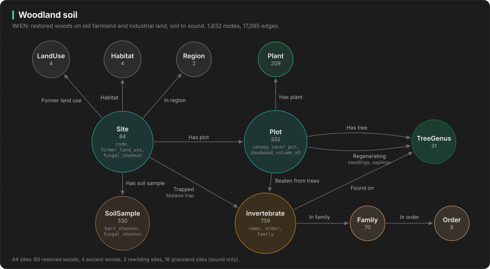

# woodland_soil: soil microbes, plants, trees, insects and sound in restored woodland



**Use it for:** post-disturbance recovery, land-use legacy, planting advice, cheap monitoring proxies.

## What the data is

The WrEN project (Woodland Creation and Ecological Networks) surveyed young broadleaved woods planted on old farmland or industrial land:
- 30 sites in Central Scotland in 2021
- 30 sites in the English Midlands in 2022
- 6 comparison sites: 4 ancient woods and 2 rewilding sites

At every site the team recorded:
- **Soil microbes**: DNA sequencing of soil bacteria and fungi, released as diversity scores (Shannon, Faith PD, Chao1) plus functional diversity (bacterial metabolic pathways from PICRUSt2, fungal guilds from FUNGuild). It also includes soil pH and conductivity. There are 5 soil samples per site.
- **Ground flora**: plant species present in 10 quadrats per site.
- **Trees**: every tree measured in 5 plots per site, plus seedlings and saplings, deadwood and canopy cover.
- **Invertebrates**: Malaise traps per site, and tray beating of named tree species per plot (spiders, beetles, true bugs, flies and more).
- **Sound**: week-long AudioMoth recordings at 84 sites, summarised as acoustic indices. These include 18 grassland sites that have no other data.
- **Site context**: age, former land use, area, connectivity, and broadleaf woodland cover from 100 m to 3 km around the site.

Sources (UKCEH Environmental Information Data Centre, Open Government Licence):
- Waddell et al. (2025) Insect, plant and tree data. [doi:10.5285/8c997943-1f90-4897-87b3-491eaef534ec](https://doi.org/10.5285/8c997943-1f90-4897-87b3-491eaef534ec)
- Hibdige et al. (2026) Soil metagenomics data. [doi:10.5285/a21b8ed1-124b-4b2a-adb4-c3fdcc9f95a2](https://doi.org/10.5285/a21b8ed1-124b-4b2a-adb4-c3fdcc9f95a2)
- Barnett et al. (2025) Acoustic monitoring data. [doi:10.5285/33b6dea2-94c5-4e33-a1b3-9a6bd1c8776a](https://doi.org/10.5285/33b6dea2-94c5-4e33-a1b3-9a6bd1c8776a)

## Size

1,832 nodes, 17,095 edges.

| Node | Count | What it is |
|---|---|---|
| `Site` | 84 | One wood or grassland. Carries the soil, sound and landscape properties. |
| `Plot` | 332 | 5 survey plots per wood |
| `SoilSample` | 330 | 5 soil samples per wood |
| `Plant` | 209 | Ground-flora species |
| `TreeGenus` | 31 | Tree genus, for example `Quercus` (oak) |
| `Invertebrate` | 759 | Finest identification available (species, genus or family) |
| `Family`, `Order` | 70, 8 | Invertebrate taxonomy |
| `LandUse`, `Habitat`, `Region` | 4, 4, 2 | Shared categories, so sites can be grouped by walking to them |

## Schema

```
(:Site)-[:FORMER_LAND_USE]->(:LandUse)         Agricultural, Industrial, Ancient woodland, Rewilding
(:Site)-[:HABITAT]->(:Habitat)                 Woodland restoration, Ancient woodland, Rewilding, Grassland
(:Site)-[:IN_REGION]->(:Region)                England, Scotland
(:Site)-[:HAS_SOIL_SAMPLE]->(:SoilSample)
(:Site)-[:HAS_PLOT]->(:Plot)
(:Plot)-[:HAS_PLANT {quadrats}]->(:Plant)
(:Plot)-[:HAS_TREE {trees, stems, mean_dbh_cm}]->(:TreeGenus)
(:Plot)-[:REGENERATING {seedlings, saplings}]->(:TreeGenus)
(:Plot)-[:BEATEN_FROM_TREES {individuals}]->(:Invertebrate)
(:Site)-[:TRAPPED {individuals, method}]->(:Invertebrate)        Malaise trap
(:Invertebrate)-[:FOUND_ON {individuals, sites}]->(:TreeGenus)   insect beaten from this tree genus
(:Invertebrate)-[:IN_FAMILY]->(:Family)-[:IN_ORDER]->(:Order)
```

### Key properties

| On | Properties |
|---|---|
| `Site` | `code`, `habitat`, `region`, `former_land_use`, `age_years`, `survey_year`, `lat`, `lon`, `easting`, `northing`, `survey_area_ha`, `contiguous_area_ha`, `proximity_index`, `broadleaf_100m` to `broadleaf_3000m` (fraction of broadleaf cover within that radius) |
| `Site` soil (mean of 5 samples) | `bact_shannon`, `bact_faith_pd`, `bact_pathway_shannon`, `bact_pathway_chao1`, `fungal_shannon`, `fungal_guild_chao1`, `soil_pH`, `soil_conductivity_us` |
| `Site` sound (mean over all recordings) | `sound_recordings`, `sound_ADI` (acoustic diversity), `sound_ACIsw` (complexity), `sound_AEve` (evenness), `sound_Bio` (bioacoustic), `sound_H` (entropy), `sound_NDSI` (biophony vs human noise, -1 to 1) |
| `SoilSample` | the same soil measures per sample, plus `date`, `bacterial_id`, `fungal_id` |
| `Plot` | `canopy_cover_pct`, `deadwood_pieces`, `deadwood_volume_m3` |
| `Invertebrate` | `name`, `rank`, `order`, `family` |
| `TreeGenus` | `name`, `common_names` |

## Questions it answers

All of these are in [`queries/woodland_soil.cypher`](../queries/woodland_soil.cypher).

1. **Land-use legacy.** Do woods on old industrial land differ in soil microbes from woods on old farmland? Does that carry through to plant richness?
2. **On track to ancient woodland?** Which restoration sites share the most ground-flora species with the 4 ancient woods? The query is 6 hops.
3. **Specialists.** Which tree genera host insects found on no other tree?
4. **Planting advice.** Which trees are common at sites with the highest fungal diversity?
5. **Cheap monitoring.** One row per site joins insects, plants, soil and sound. Load it into pandas and test whether the acoustic indices track biodiversity.
6. **What is missing.** Which invertebrates are caught in ancient woods but never in restored ones?

Ideas to go further:
- Build site-to-site similarity edges (shared species) and find clusters.
- Predict soil diversity from tree mix and landscape cover.
- Rank sites for intervention: young, low diversity, little broadleaf cover nearby.

## Caveats

- The soil release has diversity scores only. There is no list of which microbes were found.
- Many invertebrates are identified only to genus or family.
- Scottish sites were surveyed in 2021 and English sites in 2022, so region and year are confounded.
- The grassland sites only have sound data.
